# BÁO CÁO THỰC HÀNH CÔNG NGHỆ .NET & C# WINFORMS

## MỤC 1: THÔNG TIN SINH VIÊN

* **Họ và tên sinh viên:** Nguyễn Tự Tiến Đạt  
* **Mã sinh viên:** 24810320260  
* **Lớp / Khóa:** D19QTANM1  

---

# BÀI 6.6: HỆ THỐNG QUẢN LÝ MƯỢN TRẢ SÁCH THƯ VIỆN (LIBRARY MANAGEMENT SYSTEM)

### MỤC 2: HÌNH ẢNH KẾT QUẢ CÁC MÀN HÌNH CHỨC NĂNG

1. **Màn hình Chính / Tổng quan hệ thống:**  
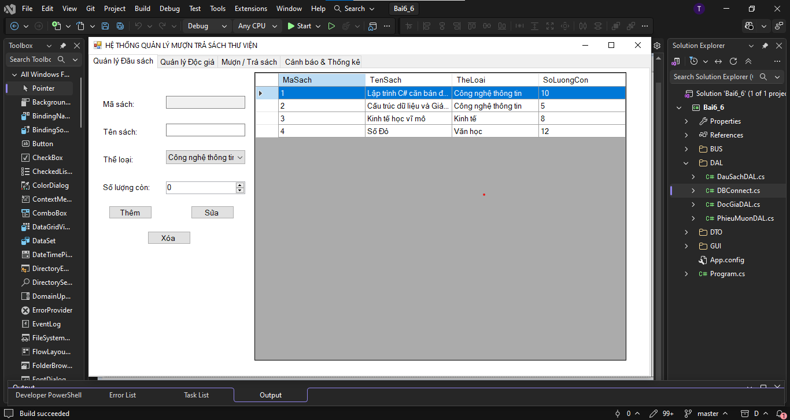

2. **Màn hình Quản lý Danh mục (CRUD - Thêm/Sửa/Xóa Đầu sách & Độc giả):**  
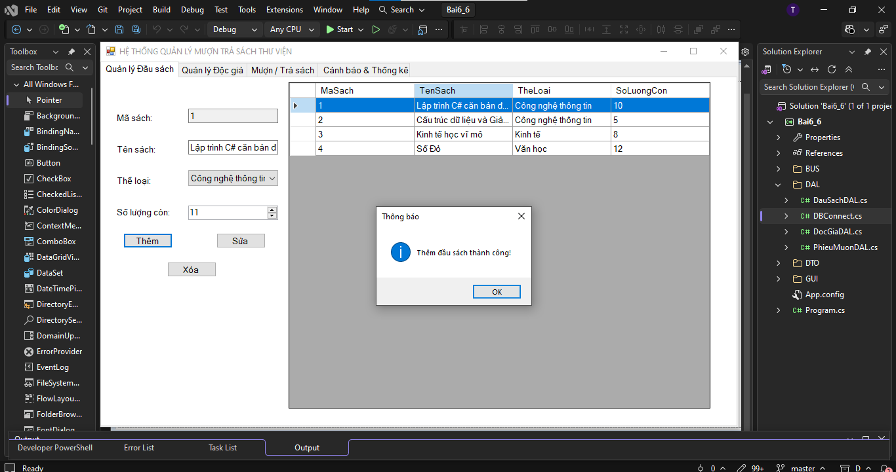

3. **Màn hình Thực thi Nghiệp vụ chính (Lập phiếu mượn, Lọc trạng thái & Trả sách):**  
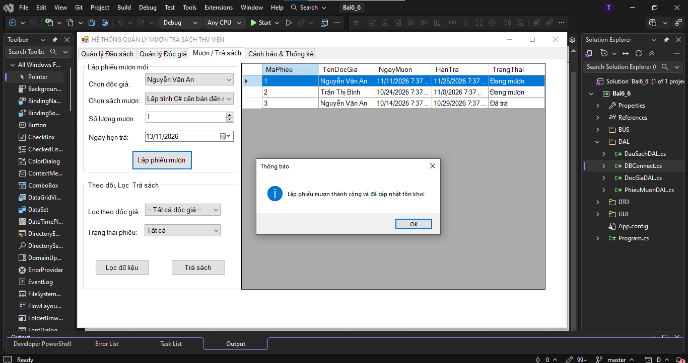

4. **Màn hình Báo cáo - Thống kê (Thống kê lượt mượn theo Thể loại):**  
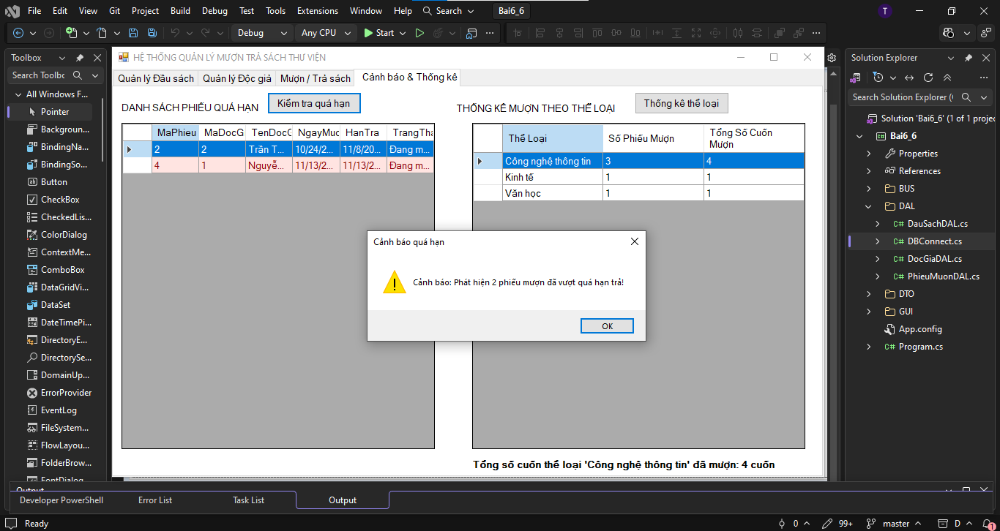

5. **Minh họa An toàn Dữ liệu (Cảnh báo Sách quá hạn Overdue & Kiểm tra hạn thẻ độc giả):**  
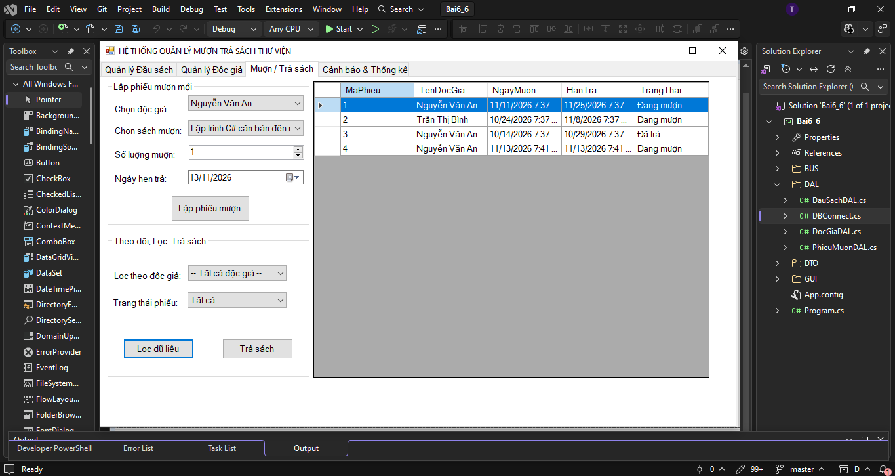

---

# BÀI 6.7: HỆ THỐNG QUẢN LÝ PHÒNG KHÁM & KÊ ĐƠN THUỐC (CLINIC & PHARMACY MANAGEMENT SYSTEM)

### MỤC 2: HÌNH ẢNH KẾT QUẢ CÁC MÀN HÌNH CHỨC NĂNG

1. **Màn hình Chính / Tổng quan hệ thống:**  
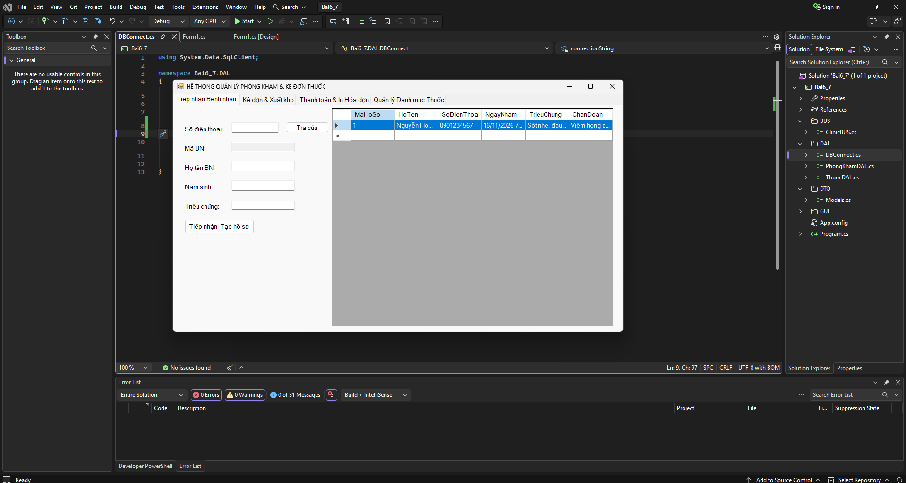

2. **Màn hình Quản lý Danh mục (CRUD - Tra cứu Bệnh nhân & Quản lý Danh mục Thuốc):**  
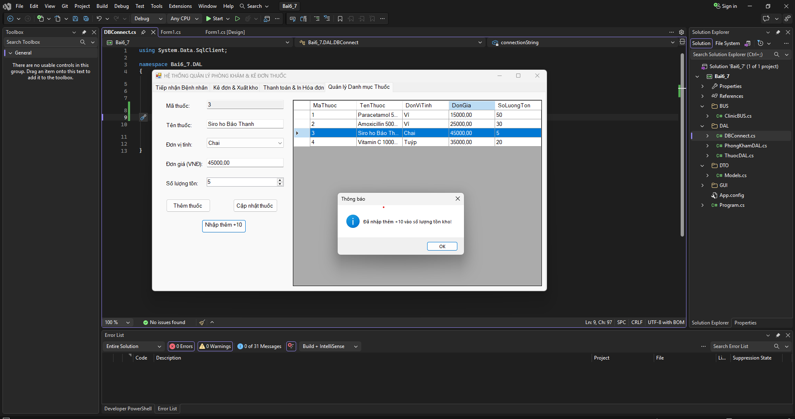

3. **Màn hình Thực thi Nghiệp vụ chính (Kê đơn thuốc & Xuất kho Dược phẩm bằng SqlTransaction):**  
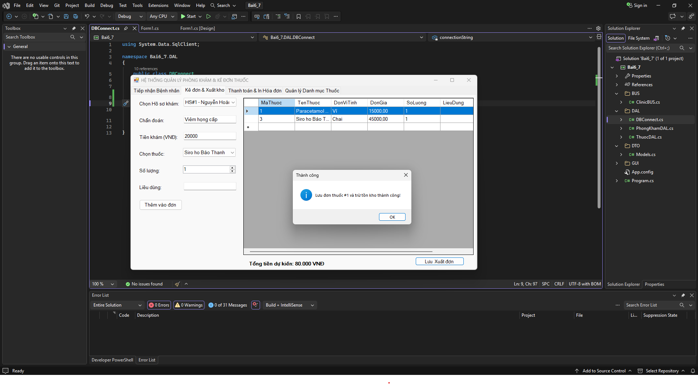

4. **Màn hình Báo cáo - Thống kê (Tính tiền khám, tiền thuốc & Thanh toán hóa đơn):**  
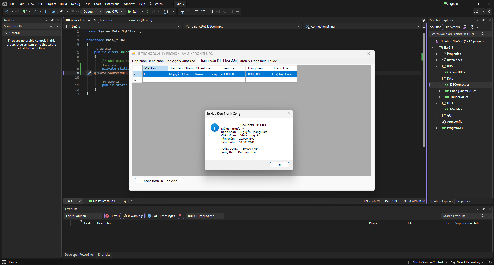

5. **Minh họa An toàn Dữ liệu (Phòng chống SQL Injection & Báo lỗi Transaction Rollback khi thuốc không đủ tồn kho):**  
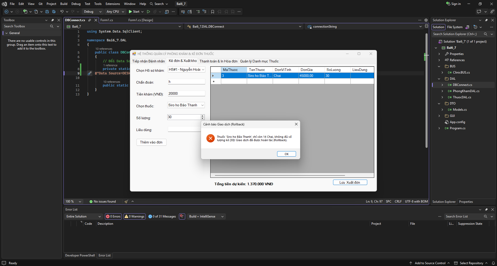

---

# BÀI 6.8: HỆ THỐNG QUẢN LÝ BÀN BIDA & DỊCH VỤ GIẢI TRÍ (BILLIARDS CLUB MANAGEMENT SYSTEM)

### MỤC 2: HÌNH ẢNH KẾT QUẢ CÁC MÀN HÌNH CHỨC NĂNG

1. **Màn hình Chính / Tổng quan hệ thống (Sơ đồ bàn Bida trực quan Visual Table Grid):**  
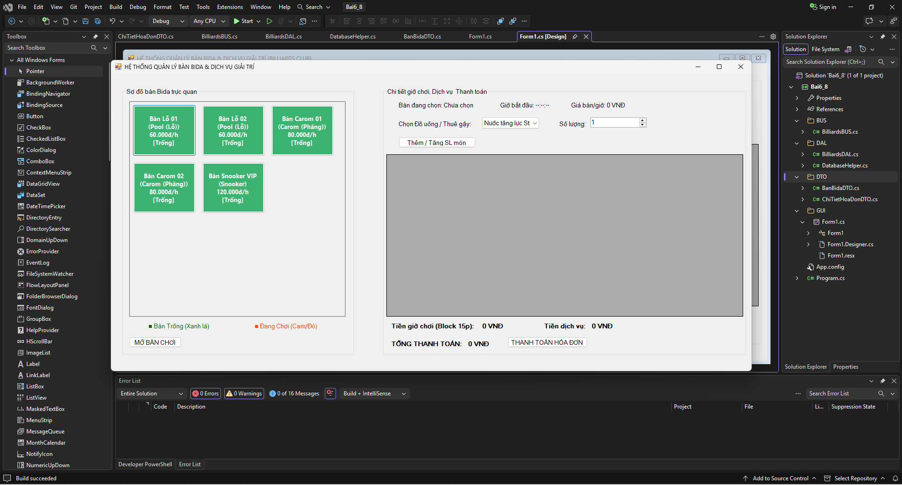

2. **Màn hình Quản lý Danh mục (CRUD - Mở bàn chơi & Chuyển trạng thái bàn trực quan):**  
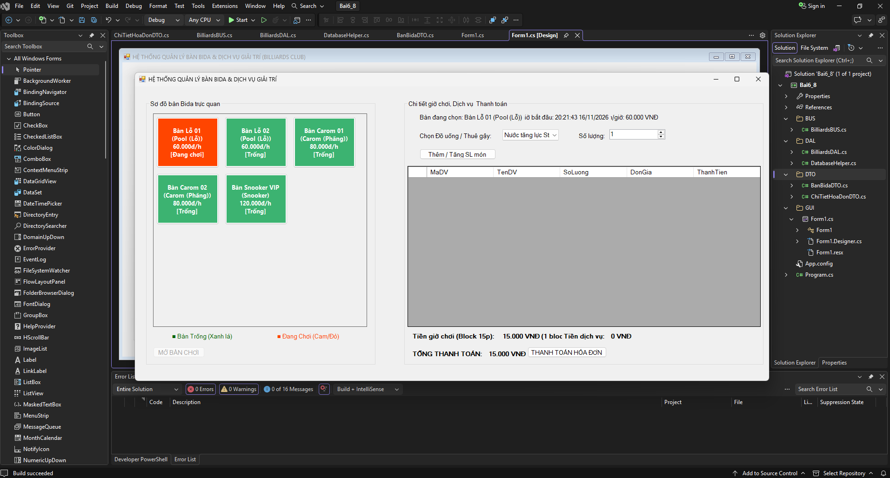

3. **Màn hình Thực thi Nghiệp vụ chính (Gọi đồ uống / Thuê gậy & Thanh toán bằng SqlTransaction):**  
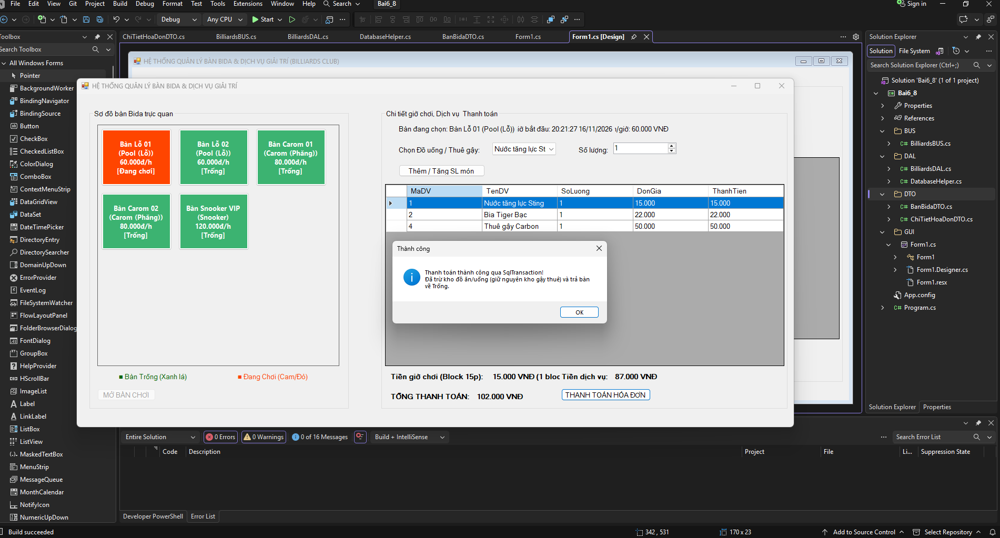

4. **Màn hình Báo cáo - Thống kê (Chi tiết hóa đơn & Tính tiền giờ làm tròn block 15 phút):**  
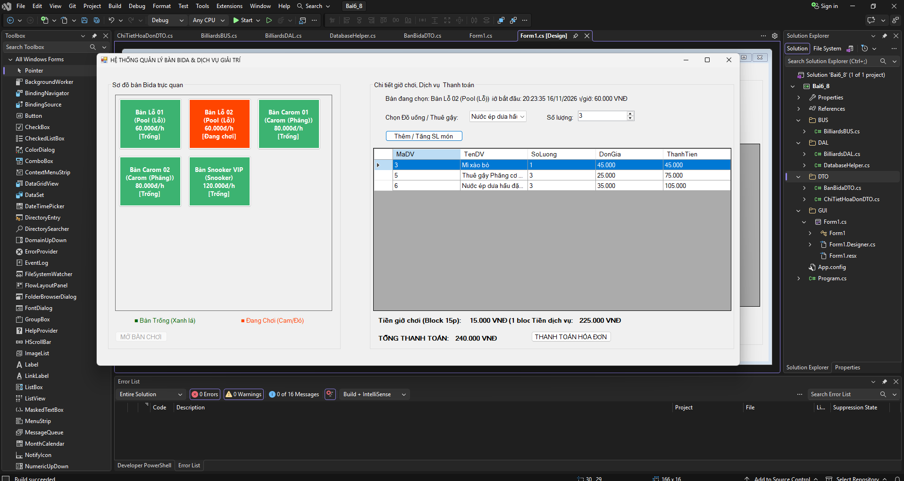

5. **Minh họa An toàn Dữ liệu (Phòng chống SQL Injection & Báo lỗi Transaction Rollback khi vượt tồn kho dịch vụ):**  
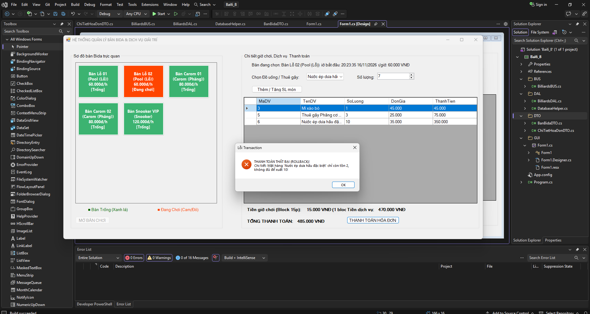